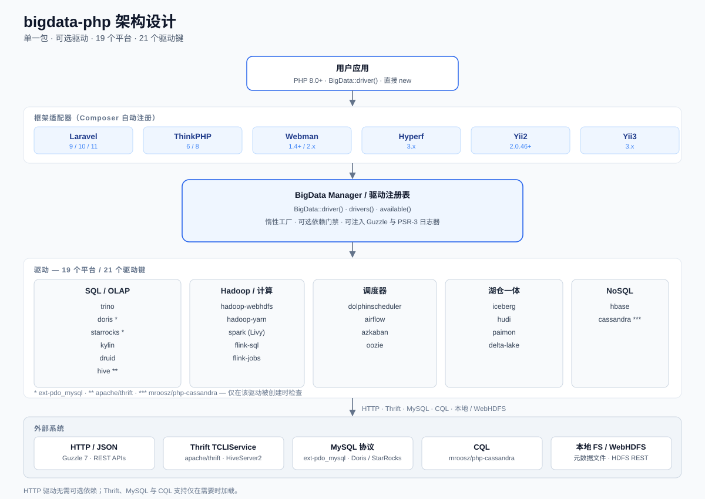
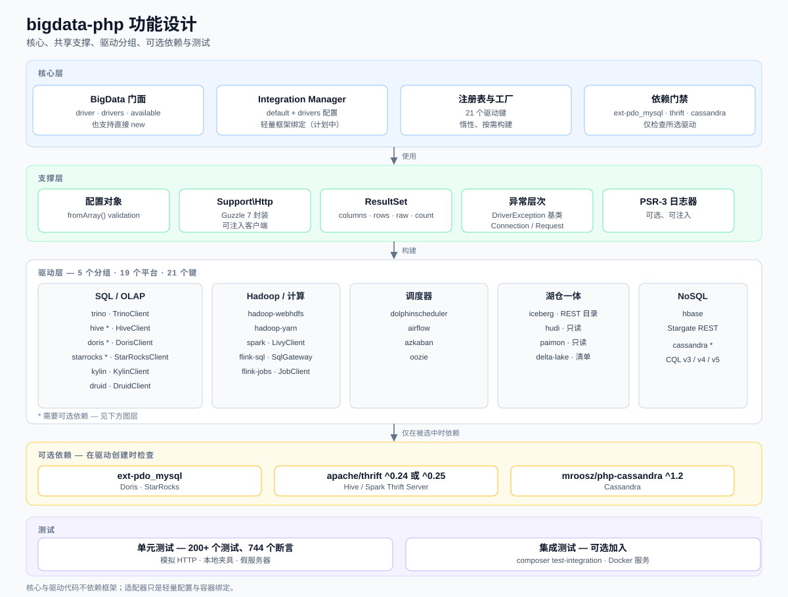
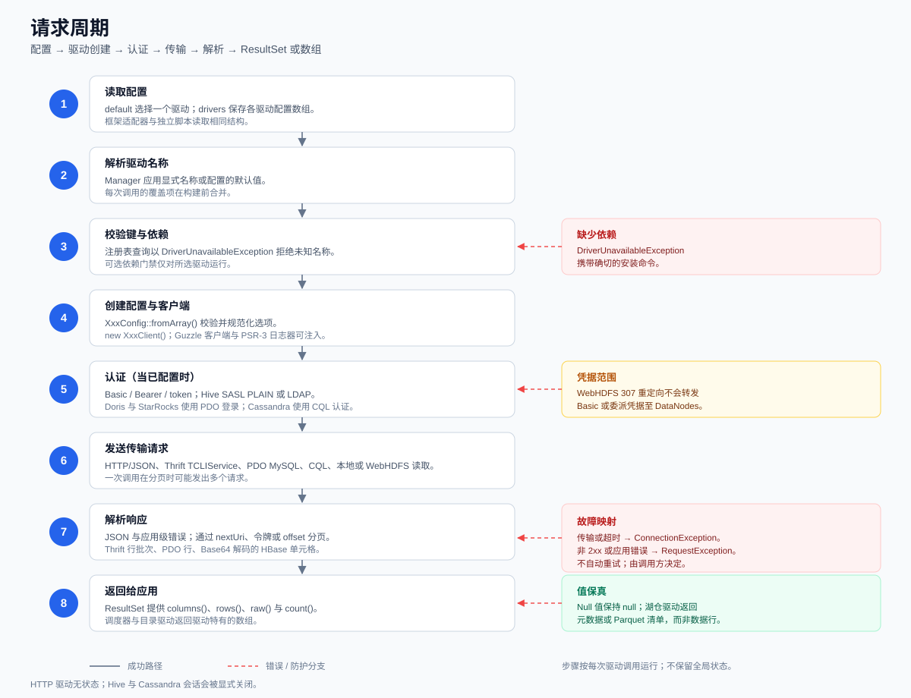
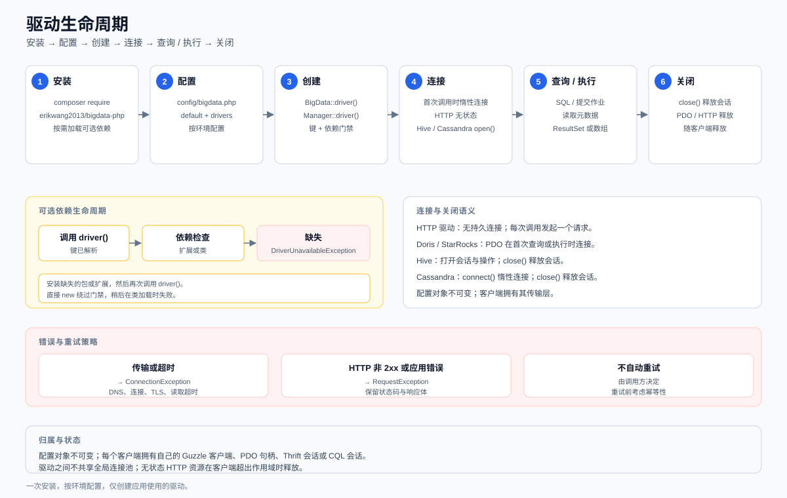

[简体中文](README.md) | [English](README_EN.md)

# bigdata-php

[](https://packagist.org/packages/erikwang2013/bigdata-php)
[](https://github.com/erikwang2013/bigdata-php/actions/workflows/ci.yml)
[](LICENSE)
[](composer.json)

一个 Composer 包，19 个大数据平台驱动，按需启用。

项目站点：https://package.erik.xyz/bigdata/ （中文 / English）

**快速链接**：[项目站点](https://package.erik.xyz/bigdata/) · [驱动文档](docs/drivers/) · [框架文档](docs/frameworks/) · [更新日志](CHANGELOG.md) · [版本发布](https://github.com/erikwang2013/bigdata-php/releases)

## 目录

| | |
|---|---|
| [1. 项目简介](#1-项目简介) | [9. 功能设计](#9-功能设计) |
| [2. 功能特性](#2-功能特性) | [10. 请求周期](#10-请求周期) |
| [3. 环境要求](#3-环境要求) | [11. 生命周期](#11-生命周期) |
| [4. 安装](#4-安装) | [12. 目录结构](#12-目录结构) |
| [5. 快速开始](#5-快速开始) | [13. 测试](#13-测试) |
| [6. 框架集成](#6-框架集成) | [14. 边界与限制](#14-边界与限制) |
| [7. 驱动矩阵](#7-驱动矩阵) | [15. License](#15-license) |
| [8. 架构设计](#8-架构设计) | [项目宠物](#项目宠物) |

`erikwang2013/bigdata-php` 用同一套 PHP API 连接 SQL / OLAP 引擎、Hadoop 生态、调度系统、湖仓元数据目录和 NoSQL 存储。HTTP 驱动开箱即用；只有真正使用 Doris / StarRocks、Hive 或 Cassandra 时，才需要安装对应的可选依赖。

## 1. 项目简介

大数据平台的 PHP 客户端通常是十几个互不相关的小包：每个包各带一份 HTTP 封装、配置解析、结果集和异常层，版本各自漂移，升级时很难保持一致。本项目把它们收进一个 Composer 包，但保留“可选驱动”的边界。

覆盖的平台包括：**Trino、Hadoop、Hive、Spark、Flink、Doris、StarRocks、Kylin、Druid、Iceberg、Hudi、Paimon、Delta Lake、DolphinScheduler、Airflow、Azkaban、Oozie、HBase、Cassandra**（共 19 个）。

- **一个包，19 个平台，21 个驱动键。** Hadoop 提供 `hadoop-webhdfs` 与 `hadoop-yarn` 两个入口，Flink 提供 `flink-sql` 与 `flink-jobs`，其余平台各一个驱动键。
- **统一入口，驱动隔离。** 包级共享的是 Guzzle 7 / PSR-3 依赖、`Support` 辅助层与统一的异常约定；每个驱动仍保留自己的 `XxxConfig`、`XxxClient`，并可按需使用专用 `ResultSet` 或异常，也可以绕过管理器直接 `new`。
- **可选依赖不拖累安装。** 基础安装只依赖 `guzzlehttp/guzzle` 与 `psr/log`。`apache/thrift`、`mroosz/php-cassandra` 在创建对应驱动时检查；`ext-pdo_mysql` 只在 Doris/StarRocks 执行 SQL 时检查。
- **湖仓格式只做元数据。** Iceberg、Hudi、Paimon、Delta Lake（Delta Sharing）驱动读取目录、schema、快照或文件清单，不解析 Parquet 数据文件；真正的行级查询交给 Trino、Spark 或 Flink。
- **不隐藏失败，不自动重试。** 连接错误映射为 `ConnectionException`，HTTP 非 2xx 或应用层错误映射为 `RequestException`，是否重试由调用方决定。

## 2. 功能特性

- **统一入口**：`BigData::driver($name, $config)` 按需创建驱动；`BigData::drivers()` 返回全部 21 个驱动键，`BigData::available()` 返回当前环境可选依赖齐全的驱动键。
- **框架无关的 Manager**：`Erikwang2013\BigData\Integration\Manager` 使用统一的 `default` / `drivers` 配置结构，按名称缓存实例；框架适配器只负责容器绑定和配置加载。
- **可选依赖检查**：缺少依赖时抛出 `Erikwang2013\BigData\Exception\DriverUnavailableException`，异常信息包含安装命令；直接 `new` 客户端则跳过检查。
- **每个驱动独立配置**：所有配置类提供 `fromArray(array $config): self`，负责必填项校验、默认值和类型转换；字段说明见各驱动文档。
- **一致的结果约定**：SQL / 查询类驱动返回 `ResultSet`，提供 `columns()`、`rows()`、`raw()`、`count()`；调度和目录类驱动返回驱动特定的数组结构。
- **可注入的 HTTP 与日志**：默认使用 Guzzle 7 和 `psr/log`，也可以在创建驱动或直接实例化时注入自定义 `ClientInterface` / `LoggerInterface`，便于测试和复用连接配置。
- **湖仓元数据只读**：Iceberg REST Catalog、Hudi `.hoodie` 时间线、Paimon schema/snapshot、Delta Sharing 文件清单。
- **无自动重试、无统一 SQL 层**：不做查询改写、事务编排、连接池或 ORM；每个驱动保持目标系统本身的语义。
- **PHP 8.0+**：核心包不依赖任何框架；Laravel、ThinkPHP、Webman、Hyperf、Yii2、Yii3 适配器均为可选薄封装。
- **测试覆盖**：294 个单元测试、978 个断言，另有 14 个集成测试（16 个断言，缺少外部服务时自动跳过），使用 mock HTTP、本地 fixture 和 fake server，不依赖真实集群。

## 3. 环境要求

| 组件 | 要求 |
|---|---|
| PHP | 8.0+ |
| guzzlehttp/guzzle | ^7.0，随包自动安装 |
| psr/log | ^3.0，随包自动安装 |
| ext-pdo_mysql | 可选；Doris、StarRocks 的 SQL 需要；Stream Load 是纯 HTTP，不需要 |
| apache/thrift | 可选；Hive / Spark Thrift Server 需要，支持 ^0.24 或 ^0.25 |
| mroosz/php-cassandra | 可选；Cassandra 需要，^1.2 |
| aws/aws-sdk-php | 可选；Hudi / Paimon 的 S3 存储需要 |

框架适配器的版本与 PHP 下限：

| 框架 | 支持版本 | PHP 下限 |
|---|---|---|
| Laravel | 9 / 10 / 11 | 9 为 8.0，10 为 8.1，11 为 8.2 |
| ThinkPHP | 6 / 8 | 包本身要求 8.0；ThinkPHP 8 也要求 8.0 |
| Webman | 1.x / 2.x | 1.x 为 8.0，2.x 为 8.1 |
| Hyperf | 3.x | 8.1，并需要 Swoole 5 |
| Yii2 | 2.0.46+ | 8.0 |
| Yii3 | 3.x | 8.1 |

框架自身的 PHP 下限可能高于本包的 8.0；以框架要求为准。

## 4. 安装

标准安装方式（Packagist 已上线）：

```bash
composer require erikwang2013/bigdata-php:^2.0
```

按需安装可选依赖：

```bash
composer require apache/thrift           # Hive / Spark Thrift Server
composer require mroosz/php-cassandra    # Cassandra
```

Doris / StarRocks 不需要额外的 Composer 包，但需要在 `php.ini` 中启用 `pdo_mysql` 扩展。

## 5. 快速开始

```php
use Erikwang2013\BigData\BigData;

$trino = BigData::driver('trino', [
    'host' => '127.0.0.1',
    'port' => 8080,
    'user' => 'php',
    'catalog' => 'hive',
    'schema' => 'default',
]);

$result = $trino->query('SELECT 1 AS id');

foreach ($result->rows() as $row) {
    echo $row[0], PHP_EOL;
}
```

`ResultSet` 的常用方法：

```php
$result->columns(); // 列名或列描述，具体结构由驱动决定
$result->rows();    // 行数组，null 值原样保留
$result->count();   // 行数
$result->raw();     // 驱动原始返回，便于排查协议细节
```

调度类驱动示例：

```php
$airflow = BigData::driver('airflow', [
    'baseUrl' => 'http://127.0.0.1:8081',
    'username' => 'admin',
    'password' => 'admin',
]);

$airflow->triggerDag('daily_etl', ['date' => '2026-10-29']);
```

可选驱动模式：

```php
BigData::drivers();   // 全部 21 个驱动键
BigData::available(); // 当前环境可选依赖齐全的驱动键

try {
    $hive = BigData::driver('hive', ['host' => '127.0.0.1']);
} catch (\Erikwang2013\BigData\Exception\DriverUnavailableException $e) {
    echo $e->getMessage(); // 包含 composer require apache/thrift 提示
}
```

驱动也可以直接实例化。直接实例化不会经过可选依赖检查，缺少扩展或类时会在运行时失败：

```php
use Erikwang2013\BigData\Driver\Trino\TrinoClient;
use Erikwang2013\BigData\Driver\Trino\TrinoConfig;

$trino = new TrinoClient(TrinoConfig::fromArray([
    'host' => '127.0.0.1',
]));
```

## 6. 框架集成

核心包不依赖任何框架。`src/Integration` 中的适配器只做两件事：读取统一的 `default` / `drivers` 配置，把 `Erikwang2013\BigData\Integration\Manager` 绑定到框架容器。

每个适配器都有独立文档：[Laravel](docs/frameworks/laravel.md)、[ThinkPHP](docs/frameworks/thinkphp.md)、[Webman](docs/frameworks/webman.md)、[Hyperf](docs/frameworks/hyperf.md)、[Yii2](docs/frameworks/yii2.md)、[Yii3](docs/frameworks/yii3.md)。

首次启动时，适配器按框架约定自动复制配置模板：Laravel、ThinkPHP、Webman、Yii2 写入 `config/bigdata.php`，Hyperf 写入 `config/autoload/bigdata.php`；Yii3 由 yiisoft/config 自动合并包内配置，无需复制。已有配置文件不会被覆盖。

统一配置结构（所有框架相同）：

```php
// config/bigdata.php
return [
    'default' => 'trino',
    'drivers' => [
        'trino' => [
            'host' => '127.0.0.1',
            'port' => 8080,
            'user' => 'php',
            'catalog' => 'hive',
            'schema' => 'default',
        ],
        'airflow' => [
            'baseUrl' => 'http://127.0.0.1:8081',
            'username' => 'admin',
            'password' => 'admin',
        ],
    ],
];
```

`Manager` 的公开行为：

- `driver()` 使用 `default`，`driver('airflow')` 使用显式名称；同一名称的实例会被缓存。
- `drivers()` 返回 `drivers` 下已配置的驱动名。
- `available()` 返回已配置且可选依赖齐全的驱动名。
- 只允许创建 `drivers` 中配置过的驱动；未知名称抛出 `InvalidArgumentException`。

### Laravel

```php
// config/app.php — Laravel 9 / 10
return [
    'providers' => [
        Erikwang2013\BigData\Integration\Laravel\BigDataServiceProvider::class,
    ],
];
```

```php
// bootstrap/providers.php — Laravel 11
return [
    Erikwang2013\BigData\Integration\Laravel\BigDataServiceProvider::class,
];
```

发布配置文件：

```bash
php artisan vendor:publish --tag=bigdata-config
```

使用：

```php
$trino = app(\Erikwang2013\BigData\Integration\Manager::class)->driver('trino');

// provider 同时注册了 "bigdata" 别名
$airflow = app('bigdata')->driver('airflow');
```

### ThinkPHP

```php
// app/service.php
return [
    Erikwang2013\BigData\Integration\ThinkPHP\BigDataService::class,
];
```

将 `src/Integration/ThinkPHP/config/bigdata.php` 复制到 `config/bigdata.php`，或按相同的 `default` / `drivers` 结构编写。服务注册后可通过容器别名或类名获取：

```php
$manager = app('bigdata');
$trino = $manager->driver('trino');
```

### Webman

```php
// config/bootstrap.php
return [
    Erikwang2013\BigData\Integration\Webman\Bootstrap::class,
];
```

将 `src/Integration/Webman/config/bigdata.php` 复制到 `config/bigdata.php`。适配器使用懒加载定义，每个 worker 进程拥有自己的 `Manager`：

```php
$manager = \support\Container::get(\Erikwang2013\BigData\Integration\Manager::class);
$trino = $manager->driver('trino');
```

### Hyperf

```php
// config/config.php
return [
    'config_providers' => [
        Erikwang2013\BigData\Integration\Hyperf\ConfigProvider::class,
    ],
];
```

配置文件放在 `config/autoload/bigdata.php`，结构同上。Hyperf 3 需要 PHP 8.1 和 Swoole 5：

```php
$manager = $container->get(\Erikwang2013\BigData\Integration\Manager::class);
$trino = $manager->driver('trino');
```

### Yii2

Yii2 没有配置自动加载，组件从 `Yii::$app->params['bigdata']` 读取驱动配置：

```php
// config/web.php
return [
    'components' => [
        'bigdata' => Erikwang2013\BigData\Integration\Yii2\BigDataComponent::class,
    ],
    'params' => [
        'bigdata' => require __DIR__ . '/bigdata.php',
    ],
];
```

`config/bigdata.php` 返回统一的 `default` / `drivers` 结构；控制台应用也需要在 `config/console.php` 中做同样的配置。

使用：

```php
$trino = Yii::$app->bigdata->driver('trino');
```

### Yii3

Yii3 通过 `ConfigProvider` 提供默认参数和 DI 定义，应用侧覆盖 `erikwang2013/bigdata-php` 段即可：

```php
// config/common/params.php
return [
    'erikwang2013/bigdata-php' => [
        'default' => 'trino',
        'drivers' => [
            'trino' => ['host' => '127.0.0.1'],
        ],
    ],
];
```

`Manager` 已注册到容器，可以注入或直接获取：

```php
final class DashboardController
{
    public function __construct(
        private \Erikwang2013\BigData\Integration\Manager $bigdata,
    ) {
    }
}
```

或直接从容器获取：

```php
$manager = $container->get(\Erikwang2013\BigData\Integration\Manager::class);
$trino = $manager->driver('trino');
```

## 7. 驱动矩阵

19 个平台、21 个驱动键。`—` 表示没有额外依赖。

| 平台 | 驱动键 | 客户端 | 可选依赖 | 说明 | 文档 |
|---|---|---|---|---|---|
| Trino | `trino` | `Driver\Trino\TrinoClient` | — | SQL 查询、catalog / schema / table 浏览 | [trino.md](docs/drivers/trino.md) |
| Hadoop | `hadoop-webhdfs` | `Driver\Hadoop\WebHdfsClient` | — | HDFS 读写，WebHDFS REST，含 307 重定向 | [hadoop.md](docs/drivers/hadoop.md) |
| Hadoop | `hadoop-yarn` | `Driver\Hadoop\YarnClient` | — | YARN 应用查询与终止 | [hadoop.md](docs/drivers/hadoop.md) |
| Hive | `hive` | `Driver\Hive\HiveClient` | `apache/thrift` | HiveServer2 / Spark Thrift Server，NONE / NOSASL / PLAIN / LDAP | [hive.md](docs/drivers/hive.md) |
| Spark | `spark` | `Driver\Spark\LivyClient` | — | Livy session / statement / batch | [spark.md](docs/drivers/spark.md) |
| Flink | `flink-sql` | `Driver\Flink\SqlGatewayClient` | — | Flink SQL Gateway | [flink.md](docs/drivers/flink.md) |
| Flink | `flink-jobs` | `Driver\Flink\JobClient` | — | JobManager 作业查询与取消 | [flink.md](docs/drivers/flink.md) |
| Doris | `doris` | `Driver\Doris\DorisClient` | `ext-pdo_mysql` (SQL) | SQL 9030 + Stream Load 8030 | [doris.md](docs/drivers/doris.md) |
| StarRocks | `starrocks` | `Driver\StarRocks\StarRocksClient` | `ext-pdo_mysql` (SQL) | SQL 9030 + Stream Load 8030 | [starrocks.md](docs/drivers/starrocks.md) |
| Kylin | `kylin` | `Driver\Kylin\KylinClient` | — | SQL / cube / job | [kylin.md](docs/drivers/kylin.md) |
| Druid | `druid` | `Driver\Druid\DruidClient` | — | SQL / native query | [druid.md](docs/drivers/druid.md) |
| Iceberg | `iceberg` | `Driver\Iceberg\RestCatalogClient` | — | REST Catalog 元数据 | [iceberg.md](docs/drivers/iceberg.md) |
| Hudi | `hudi` | `Driver\Hudi\HudiTable` | `aws/aws-sdk-php` (S3 可选) | 只读 `.hoodie` 时间线，本地 / WebHDFS / S3 | [hudi.md](docs/drivers/hudi.md) |
| Paimon | `paimon` | `Driver\Paimon\PaimonTable` | `aws/aws-sdk-php` (S3 可选) | 只读 schema / snapshot，本地 / WebHDFS / S3 | [paimon.md](docs/drivers/paimon.md) |
| Delta Lake | `delta-lake` | `Driver\DeltaLake\DeltaSharingClient` | — | Delta Sharing，返回 Parquet 文件清单 | [delta-lake.md](docs/drivers/delta-lake.md) |
| DolphinScheduler | `dolphinscheduler` | `Driver\DolphinScheduler\DolphinSchedulerClient` | — | 项目 / 工作流 / 实例 / 日志 | [dolphinscheduler.md](docs/drivers/dolphinscheduler.md) |
| Airflow | `airflow` | `Driver\Airflow\AirflowClient` | — | DAG / run / task / 变量 | [airflow.md](docs/drivers/airflow.md) |
| Azkaban | `azkaban` | `Driver\Azkaban\AzkabanClient` | — | 登录 / flow / 执行 / 日志 | [azkaban.md](docs/drivers/azkaban.md) |
| Oozie | `oozie` | `Driver\Oozie\OozieClient` | — | workflow / coordinator / bundle | [oozie.md](docs/drivers/oozie.md) |
| HBase | `hbase` | `Driver\HBase\HBaseClient` | — | Stargate REST，Base64 单元格 | [hbase.md](docs/drivers/hbase.md) |
| Cassandra | `cassandra` | `Driver\Cassandra\CassandraClient` | `mroosz/php-cassandra` | CQL，协议 v3 / v4 / v5 | [cassandra.md](docs/drivers/cassandra.md) |

驱动键与客户端类的完整命名空间前缀是 `Erikwang2013\BigData\`。例如 `Driver\Trino\TrinoClient` 的完整类名是 `Erikwang2013\BigData\Driver\Trino\TrinoClient`。

Hudi / Paimon 通过 `BigData::driver()` 使用时必须提供 `base_path`，可选 `storage`（`local` 或 `webhdfs`）以及 WebHDFS 的 `host` / `port` / `user`：

```php
$table = BigData::driver('hudi', ['base_path' => '/warehouse/orders']);
$latest = $table->latestCommit();
```

## 8. 架构设计



调用路径：

1. **应用层**：业务代码直接调用 `BigData::driver()`，或通过框架适配器从容器取得 `Integration\Manager`。
2. **框架适配层（可选）**：Laravel、ThinkPHP、Webman、Hyperf、Yii2、Yii3 适配器读取 `default` / `drivers` 配置，把 `Manager` 绑定到容器；不引入 ORM、查询构造器或额外抽象。
3. **Manager / Registry**：`Manager` 负责配置解析和实例缓存；`BigData` 内部维护 21 个驱动键到工厂闭包的静态映射，未知键和缺失的可选依赖都在这里拦截。
4. **驱动层**：每个平台一个目录，包含 `XxxConfig`、`XxxClient`（部分驱动还有专用 `ResultSet` 或异常）。通用 HTTP、结果集、配置读取和异常位于 `src/Support/` 与 `src/Exception/`，驱动只依赖自己的配置和注入的 HTTP / 日志实例。
5. **外部系统**：HTTP / JSON（Guzzle 7）、Thrift TCLIService、MySQL 协议（PDO）、CQL、本地文件系统或 WebHDFS。

关键约束：驱动按需创建、按名称缓存；`Manager` 不会在构造时连接任何外部系统；HTTP 客户端和日志器可以从上层注入，便于统一超时、代理和日志配置。

## 9. 功能设计



代码分为五层：

- **Core**：`BigData` 门面（`driver` / `drivers` / `available`）、`Integration\Manager`、驱动注册表和可选依赖闸门。核心层只做名称解析、配置合并和工厂调用。
- **Support**：共享的 `Support\Http`（Guzzle 7 薄封装）、`Support\ResultSet`、`Support\Config`，以及以 `BigDataException` 为根的异常体系；连接失败与请求失败分别落到 `ConnectionException` 和 `RequestException`。Hive、Cassandra、Doris、StarRocks 保留专用异常层级，Hudi/Paimon/Delta Lake 的元数据错误保留 `HudiException` / `PaimonException` / `DeltaLakeException`。
- **Driver**：按平台隔离的 19 个目录，分为 SQL / OLAP、Hadoop / compute、Schedulers、Lakehouse、NoSQL 五组。驱动之间不共享客户端实例，也不存在跨驱动的统一 SQL 层。
- **Optional dependencies**：`ext-pdo_mysql`（仅 Doris/StarRocks SQL）、`apache/thrift`、`mroosz/php-cassandra`、`aws/aws-sdk-php`（仅 S3）。Hive/Cassandra 在创建驱动时检查，PDO 在 SQL 调用时检查，S3 在读取时检查。
- **Tests**：单元测试使用 mock HTTP、本地 fixture 和 fake server；集成测试独立成组，按需连接真实服务。

这套结构的目标是“统一入口，不统一语义”：配置、结果集和异常命名保持一致，但每个驱动仍按目标系统的协议和错误模型工作。

## 10. 请求周期



一次典型的驱动调用经过 8 步：

1. **读取配置**：应用或框架适配器读取 `default` 与 `drivers`；独立脚本直接把配置数组传给 `BigData::driver()`。
2. **解析驱动名**：`Manager` 使用显式名称或默认名称；直接调用 `BigData` 时由调用方传入名称。
3. **校验驱动键与可选依赖**：注册表检查名称；`doris` / `starrocks` 检查 `pdo_mysql`，`hive` 检查 `apache/thrift`，`cassandra` 检查 `mroosz/php-cassandra`。
4. **创建配置与客户端**：工厂调用 `XxxConfig::fromArray()`，再构造 `XxxClient`；Guzzle 客户端和 PSR-3 日志器可以注入。
5. **认证（如需要）**：HTTP Basic / Bearer / token、Hive SASL PLAIN 或 LDAP、Doris / StarRocks 的 PDO 登录、Cassandra 的 CQL 认证。
6. **发送传输请求**：HTTP/JSON、Thrift TCLIService、PDO MySQL、CQL、本地或 WebHDFS 读取；分页请求可能在这一步发出多次。
7. **解析响应**：处理 JSON 与 HTTP 200 下的应用层错误，跟随 `nextUri`、结果 token 或 offset，解析 Thrift 行批次、PDO 行或 Base64 编码的 HBase 单元格。
8. **返回结果**：查询类驱动返回 `ResultSet`，调度 / 目录类驱动返回驱动特定的数组；Hive 和 Cassandra 的会话由调用方显式 `close()`。

错误映射：传输失败、超时和连接错误抛出 `ConnectionException`；HTTP 非 2xx 或应用层错误抛出 `RequestException`。所有驱动都不自动重试，调用方需要根据幂等性决定是否重试。

## 11. 生命周期



| 阶段 | 做什么 |
|---|---|
| 安装 | `composer require erikwang2013/bigdata-php`；只在需要时安装 `apache/thrift`、`mroosz/php-cassandra` 或启用 `pdo_mysql`。 |
| 配置 | 准备 `default` / `drivers` 数组，或发布框架配置文件；每个驱动的字段见对应文档。 |
| 创建 | `BigData::driver($name, $config)` 或 `Manager::driver($name)`；此时检查驱动键与可选依赖。 |
| 连接 | 大多数驱动在第一次查询或执行时才建立连接；HTTP 驱动无持久连接，PDO、Hive、Cassandra 按需打开。 |
| 查询 / 执行 | 执行 SQL、提交作业、读取元数据或写入 Stream Load；结果返回 `ResultSet` 或数组。 |
| 关闭 | Hive 和 Cassandra 提供 `close()` 释放会话；PDO 和 HTTP 资源随客户端实例释放。 |

可选依赖的生命周期是独立的：Hive/Cassandra 在创建驱动时检查类，`ext-pdo_mysql` 在 Doris/StarRocks 首次执行 SQL 时检查，S3 存储在首次读取时检查；缺失时抛出带安装提示的异常。直接 `new` 客户端会绕过创建期的检查。

## 12. 目录结构

```text
bigdata-php/
├── src/
│   ├── BigData.php              # 驱动注册、工厂与可选依赖检查
│   ├── Driver/
│   │   ├── Trino/
│   │   ├── Hadoop/
│   │   ├── Hive/
│   │   ├── Spark/
│   │   ├── Flink/
│   │   ├── Doris/
│   │   ├── StarRocks/
│   │   ├── Kylin/
│   │   ├── Druid/
│   │   ├── Iceberg/
│   │   ├── Hudi/
│   │   ├── Paimon/
│   │   ├── DeltaLake/
│   │   ├── DolphinScheduler/
│   │   ├── Airflow/
│   │   ├── Azkaban/
│   │   ├── Oozie/
│   │   ├── HBase/
│   │   └── Cassandra/
│   ├── Integration/             # 框架适配器与 Manager
│   │   ├── Manager.php
│   │   ├── Laravel/
│   │   ├── ThinkPHP/
│   │   ├── Webman/
│   │   ├── Hyperf/
│   │   ├── Yii2/
│   │   └── Yii3/
│   ├── Support/                 # 共享 HTTP、ResultSet、配置辅助
│   └── Exception/
│       ├── BigDataException.php
│       ├── ConnectionException.php
│       ├── RequestException.php
│       └── DriverUnavailableException.php
├── config/                      # 框架配置样例
├── docs/
│   ├── diagrams/                # 中英文架构、功能、请求周期、生命周期 SVG
│   ├── drivers/                 # 19 个平台的详细文档（en/ 为英文版）
│   ├── frameworks/              # 6 个框架适配文档（en/ 为英文版）
│   ├── pet.svg / pet-expressions/  # 项目宠物及 12 种表情
│   └── site/                    # 站点内容源、构建与部署配置
├── scripts/                     # 站点构建 / 检查脚本
├── site/                        # 本地站点构建产物（gitignore，不随发布打包）
├── tests/
│   ├── Driver/                  # 单元测试与 fixture
│   └── Integration/             # 按需运行的集成测试
├── demo/                        # Trino / Flink / Airflow / Cassandra 演示
├── composer.json
├── phpstan.neon
├── phpunit.xml / phpunit-8.0.xml
├── ASSETS-LICENSE.md
├── CHANGELOG.md
├── README.md
└── README_EN.md
```

## 13. 测试

```bash
composer test              # 单元测试，不依赖真实集群
composer test-integration  # 集成测试，需要可用的外部服务
```

单元测试使用 mock HTTP 客户端、本地 fixture 和 fake server，覆盖 294 个测试、978 个断言；另有 14 个集成测试。测试套件在 `phpunit.xml` 中分为 `unit` 和 `integration` 两组；默认的 `composer test` 只运行 `unit`，不包含 `tests/Integration`。

集成测试按需运行，例如 Cassandra 需要可访问的实例；`demo/` 下提供了 Trino、Flink、Airflow 和 Cassandra 的 Docker Compose 配置，可作为本地验证起点。

## 14. 边界与限制

- **湖仓只读元数据**：Iceberg 读取 REST Catalog 和表元数据；Hudi 读取 `.hoodie` 时间线；Paimon 读取 schema / snapshot；Delta Sharing 返回 Parquet 文件清单。它们都不读取 Parquet 行数据，也不做谓词下推或查询执行。
- **Delta Sharing 不返回行**：`DeltaSharingClient::query()` 返回文件清单和元数据，实际数据需要由调用方按清单读取。
- **Hive 认证范围**：支持 NONE、NOSASL、SASL PLAIN 和 LDAP（QOP `auth`）；NONE/PLAIN/LDAP 使用 SASL PLAIN，NOSASL 关闭 SASL；不支持 Kerberos / GSSAPI。binary 传输可通过 `tls => true` 使用 TLS；HTTP 传输通过 `scheme => https`。
- **Cassandra 可选且可能命名冲突**：驱动包装 `mroosz/php-cassandra`，与 `ext-cassandra` 共用 `Cassandra\` 命名空间，同时加载时可能冲突。
- **不做自动重试**：连接、HTTP 和应用层错误直接抛出 `ConnectionException` / `RequestException`；重试策略、退避和幂等判断由调用方负责。
- **没有统一 SQL 层或 ORM**：驱动只做协议适配，不做 SQL 方言转换、跨源 JOIN、事务编排、连接池或模型映射。
- **可选依赖检查只在 `BigData::driver()`**：直接实例化客户端会跳过检查，缺失的扩展或类会在运行时以 PHP 错误暴露。
- **驱动能力不对称**：每个平台只覆盖其公开 API 的一部分；具体方法、配置字段和限制以 `docs/drivers/` 下的文档为准。

## 15. License

MIT。详见 [LICENSE](LICENSE)。

## 项目宠物


多多是 bigdata-php 的项目宠物：八条彩色触手连接 SQL/OLAP、Hadoop、湖仓、调度和 NoSQL，头顶的 19 徽章代表 19 个平台。


十二种表情：微笑（smile）、开心（joy）、哭泣（cry）、低落（depressed）、惊恐（terrified）、生气（angry）、撒娇（coquettish）、可爱（cute）、愉悦（pleasing）、敲门（knocking）、捂脸（facepalm）、吐舌（tongue）。源文件见 [docs/pet-expressions](docs/pet-expressions)。
