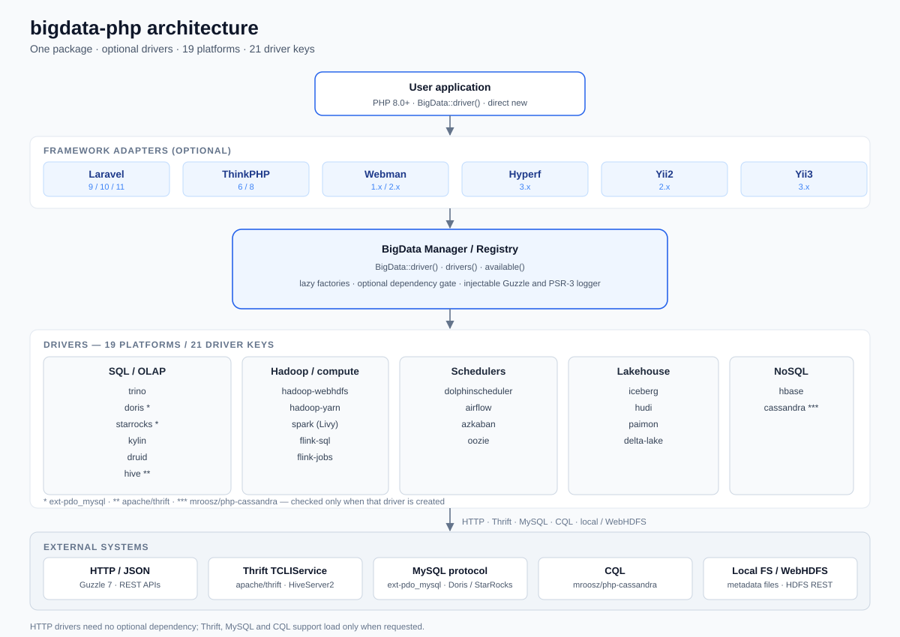
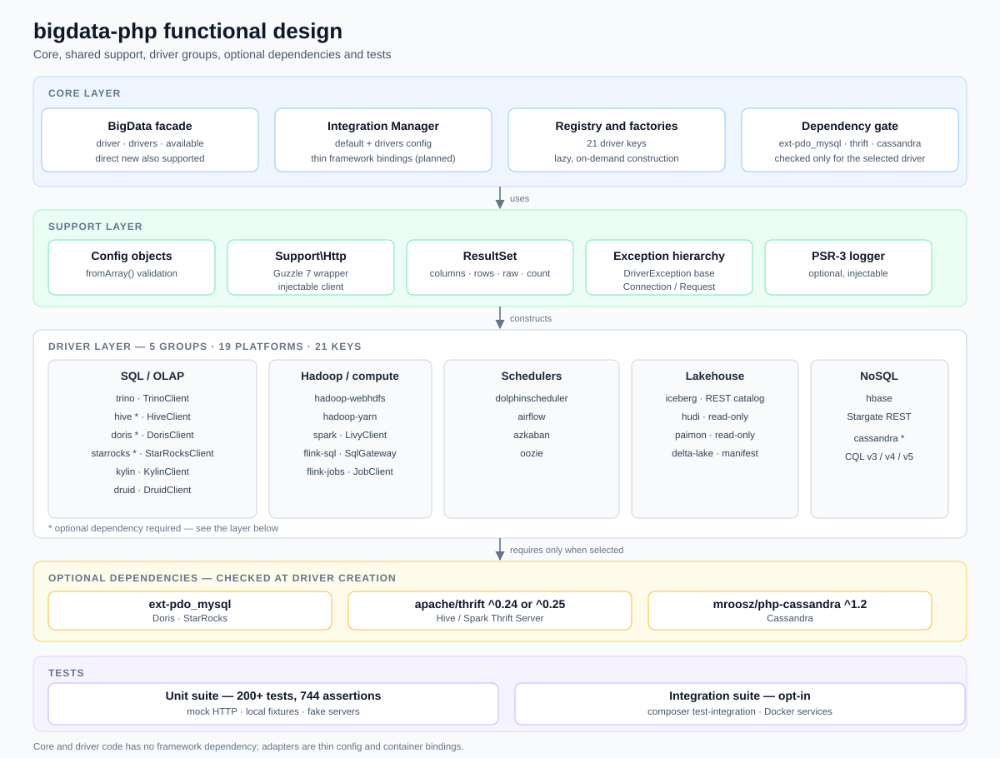
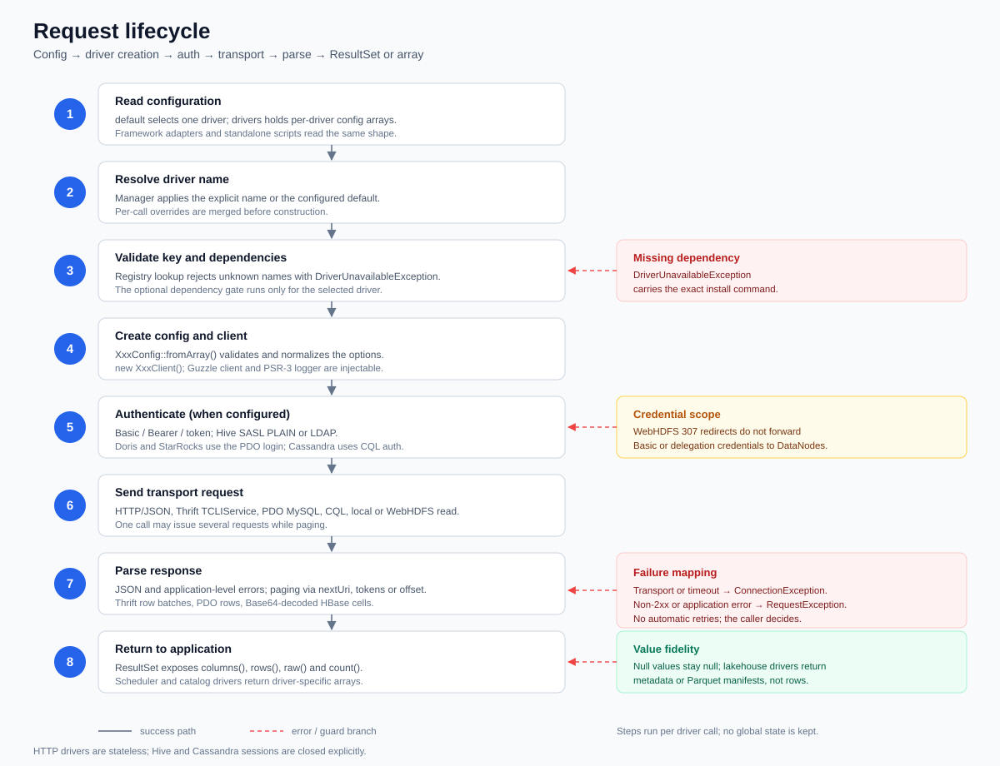
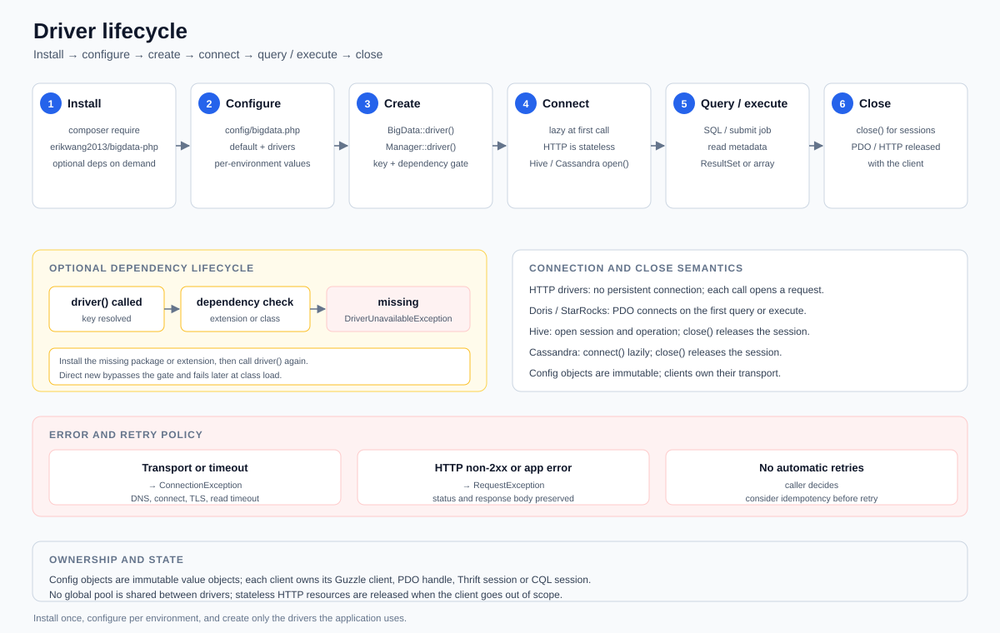
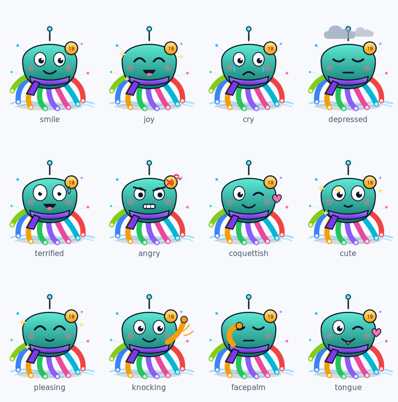

[简体中文](README.md) | English

# bigdata-php

[](https://packagist.org/packages/erikwang2013/bigdata-php)
[](https://github.com/erikwang2013/bigdata-php/actions/workflows/ci.yml)
[](LICENSE)
[](composer.json)

A Composer package with 19 big-data platform drivers, enabled on demand.

Project site: https://package.erik.xyz/bigdata/ (Chinese / English)

**Quick links**: [Project site](https://package.erik.xyz/bigdata/en.html) · [Driver docs](docs/drivers/en/) · [Framework docs](docs/frameworks/en/) · [Changelog](CHANGELOG.md) · [Releases](https://github.com/erikwang2013/bigdata-php/releases)

## Table of Contents

| | |
|---|---|
| [1. Introduction](#1-introduction) | [9. Functional Design](#9-functional-design) |
| [2. Features](#2-features) | [10. Request Lifecycle](#10-request-lifecycle) |
| [3. Requirements](#3-requirements) | [11. Lifecycle](#11-lifecycle) |
| [4. Installation](#4-installation) | [12. Directory Structure](#12-directory-structure) |
| [5. Quick Start](#5-quick-start) | [13. Tests](#13-tests) |
| [6. Framework Integration](#6-framework-integration) | [14. Limitations](#14-limitations) |
| [7. Driver Matrix](#7-driver-matrix) | [15. License](#15-license) |
| [8. Architecture](#8-architecture) | [Project Pet](#project-pet) |

`erikwang2013/bigdata-php` connects to SQL / OLAP engines, the Hadoop ecosystem, schedulers, lakehouse metadata catalogs, and NoSQL stores through one PHP API. HTTP drivers work out of the box; optional dependencies are only needed when you actually use Doris / StarRocks, Hive, or Cassandra.

## 1. Introduction

PHP clients for big-data platforms are usually a dozen unrelated small packages: each ships its own HTTP wrapper, config parsing, result set, and exception layer, versions drift apart, and upgrades are hard to keep in sync. This project brings them into a single Composer package while preserving the "optional driver" boundary.

Covered platforms: **Trino, Hadoop, Hive, Spark, Flink, Doris, StarRocks, Kylin, Druid, Iceberg, Hudi, Paimon, Delta Lake, DolphinScheduler, Airflow, Azkaban, Oozie, HBase, Cassandra** (19 in total).

- **One package, 19 platforms, 21 driver keys.** Hadoop exposes `hadoop-webhdfs` and `hadoop-yarn`; Flink exposes `flink-sql` and `flink-jobs`; every other platform has one driver key.
- **Unified entry point, isolated drivers.** What the package shares is the Guzzle 7 / PSR-3 dependency and common config and exception conventions; each driver keeps its own `XxxConfig`, `XxxClient`, `ResultSet`, and exception classes, and can also be `new`-ed directly, bypassing the manager.
- **Optional dependencies do not weigh down installation.** A base install depends only on `guzzlehttp/guzzle` and `psr/log`. `apache/thrift` and `mroosz/php-cassandra` are checked when the driver is created; `ext-pdo_mysql` is checked only when Doris/StarRocks executes SQL.
- **Lakehouse formats are metadata-only.** The Iceberg, Hudi, Paimon, and Delta Lake (Delta Sharing) drivers read catalogs, schemas, snapshots, or file manifests; they do not parse Parquet data files. Actual row-level queries are delegated to Trino, Spark, or Flink.
- **No hidden failures, no automatic retries.** Connection errors map to `ConnectionException`; HTTP non-2xx responses or application-level errors map to `RequestException`. The caller decides whether to retry.

## 2. Features

- **Unified entry point**: `BigData::driver($name, $config)` creates a driver on demand; `BigData::drivers()` returns all 21 driver keys, and `BigData::available()` returns the driver keys whose optional dependencies are present in the current environment.
- **Framework-agnostic Manager**: `Erikwang2013\BigData\Integration\Manager` uses the unified `default` / `drivers` config structure and caches instances by name; framework adapters only handle container binding and config loading.
- **Optional dependency checks**: when a dependency is missing, `Erikwang2013\BigData\Exception\DriverUnavailableException` is thrown, with an install command in the message; directly `new`-ing a client skips the check.
- **Independent configuration per driver**: every config class provides `fromArray(array $config): self`, handling required-field validation, defaults, and type conversion; see each driver's documentation for field descriptions.
- **Consistent result conventions**: SQL / query drivers return `ResultSet`, offering `columns()`, `rows()`, `raw()`, and `count()`; scheduler and catalog drivers return driver-specific array structures.
- **Injectable HTTP and logging**: Guzzle 7 and `psr/log` are used by default, and a custom `ClientInterface` / `LoggerInterface` can be injected when creating a driver or instantiating directly, which helps with testing and sharing connection settings.
- **Read-only lakehouse metadata**: Iceberg REST Catalog, Hudi `.hoodie` timeline, Paimon schema/snapshot, Delta Sharing file manifests.
- **No automatic retries, no unified SQL layer**: no query rewriting, transaction orchestration, connection pooling, or ORM; each driver preserves the semantics of the target system.
- **PHP 8.0+**: the core package depends on no framework; the Laravel, ThinkPHP, Webman, Hyperf, Yii2, and Yii3 adapters are all optional thin wrappers.
- **Test coverage**: 292 unit tests and 975 assertions, plus 14 integration tests (16 assertions, automatically skipped when external services are unavailable), using mock HTTP, local fixtures, and a fake server, with no dependency on a real cluster.

## 3. Requirements

| Component | Requirement |
|---|---|
| PHP | 8.0+ |
| guzzlehttp/guzzle | ^7.0, installed automatically with the package |
| psr/log | ^3.0, installed automatically with the package |
| ext-pdo_mysql | Optional; required for Doris/StarRocks SQL; Stream Load is plain HTTP |
| apache/thrift | Optional; required for Hive / Spark Thrift Server, supports ^0.24 or ^0.25 |
| mroosz/php-cassandra | Optional; required for Cassandra, ^1.2 |
| aws/aws-sdk-php | Optional; required for Hudi/Paimon S3 storage |

Framework adapter versions and minimum PHP versions:

| Framework | Supported versions | Minimum PHP |
|---|---|---|
| Laravel | 9 / 10 / 11 | 8.0 for 9, 8.1 for 10, 8.2 for 11 |
| ThinkPHP | 6 / 8 | The package itself requires 8.0; ThinkPHP 8 also requires 8.0 |
| Webman | 1.x / 2.x | 8.0 for 1.x, 8.1 for 2.x |
| Hyperf | 3.x | 8.1, and requires Swoole 5 |
| Yii2 | 2.0.46+ | 8.0 |
| Yii3 | 3.x | 8.1 |

A framework's own minimum PHP version may be higher than this package's 8.0; the framework requirement takes precedence.

## 4. Installation

Standard installation (available on Packagist):

```bash
composer require erikwang2013/bigdata-php:^2.0
```

Install optional dependencies as needed:

```bash
composer require apache/thrift           # Hive / Spark Thrift Server
composer require mroosz/php-cassandra    # Cassandra
```

Doris / StarRocks need no extra Composer package, but the `pdo_mysql` extension must be enabled in `php.ini`.

## 5. Quick Start

```php
use Erikwang2013\BigData\BigData;

$trino = BigData::driver('trino', [
    'host' => '127.0.0.1',
    'port' => 8080,
    'user' => 'php',
    'catalog' => 'hive',
    'schema' => 'default',
]);

$result = $trino->query('SELECT 1 AS id');

foreach ($result->rows() as $row) {
    echo $row[0], PHP_EOL;
}
```

Common `ResultSet` methods:

```php
$result->columns(); // Column names or column descriptions; exact structure is driver-defined
$result->rows();    // Row arrays; null values are preserved as-is
$result->count();   // Number of rows
$result->raw();     // Raw driver response, useful for debugging protocol details
```

Scheduler-driver example:

```php
$airflow = BigData::driver('airflow', [
    'baseUrl' => 'http://127.0.0.1:8081',
    'username' => 'admin',
    'password' => 'admin',
]);

$airflow->triggerDag('daily_etl', ['date' => '2026-10-29']);
```

Optional-driver mode:

```php
BigData::drivers();   // All 21 driver keys
BigData::available(); // Driver keys whose optional dependencies are present in the current environment

try {
    $hive = BigData::driver('hive', ['host' => '127.0.0.1']);
} catch (\Erikwang2013\BigData\Exception\DriverUnavailableException $e) {
    echo $e->getMessage(); // Contains a composer require apache/thrift hint
}
```

Drivers can also be instantiated directly. Direct instantiation bypasses the optional dependency check; a missing extension or class fails at runtime:

```php
use Erikwang2013\BigData\Driver\Trino\TrinoClient;
use Erikwang2013\BigData\Driver\Trino\TrinoConfig;

$trino = new TrinoClient(TrinoConfig::fromArray([
    'host' => '127.0.0.1',
]));
```

## 6. Framework Integration

The core package depends on no framework. The adapters in `src/Integration` do only two things: read the unified `default` / `drivers` configuration and bind `Erikwang2013\BigData\Integration\Manager` to the framework container.

Each adapter has a dedicated guide: [Laravel](docs/frameworks/en/laravel.md), [ThinkPHP](docs/frameworks/en/thinkphp.md), [Webman](docs/frameworks/en/webman.md), [Hyperf](docs/frameworks/en/hyperf.md), [Yii2](docs/frameworks/en/yii2.md), [Yii3](docs/frameworks/en/yii3.md).

On first boot the adapter copies the config template to the framework's conventional path: `config/bigdata.php` for Laravel, ThinkPHP, Webman, and Yii2, and `config/autoload/bigdata.php` for Hyperf. Yii3 needs no copy because yiisoft/config merges the package config automatically. Existing files are never overwritten.

Unified configuration structure (identical across frameworks):

```php
// config/bigdata.php
return [
    'default' => 'trino',
    'drivers' => [
        'trino' => [
            'host' => '127.0.0.1',
            'port' => 8080,
            'user' => 'php',
            'catalog' => 'hive',
            'schema' => 'default',
        ],
        'airflow' => [
            'baseUrl' => 'http://127.0.0.1:8081',
            'username' => 'admin',
            'password' => 'admin',
        ],
    ],
];
```

Public behavior of `Manager`:

- `driver()` uses `default`; `driver('airflow')` uses an explicit name; instances with the same name are cached.
- `drivers()` returns the driver names configured under `drivers`.
- `available()` returns the configured driver names whose optional dependencies are all present.
- Only drivers configured in `drivers` can be created; an unknown name throws `InvalidArgumentException`.

### Laravel

```php
// config/app.php — Laravel 9 / 10
return [
    'providers' => [
        Erikwang2013\BigData\Integration\Laravel\BigDataServiceProvider::class,
    ],
];
```

```php
// bootstrap/providers.php — Laravel 11
return [
    Erikwang2013\BigData\Integration\Laravel\BigDataServiceProvider::class,
];
```

Publish the configuration file:

```bash
php artisan vendor:publish --tag=bigdata-config
```

Usage:

```php
$trino = app(\Erikwang2013\BigData\Integration\Manager::class)->driver('trino');

// The provider also registers the "bigdata" alias
$airflow = app('bigdata')->driver('airflow');
```

### ThinkPHP

```php
// app/service.php
return [
    Erikwang2013\BigData\Integration\ThinkPHP\BigDataService::class,
];
```

Copy `src/Integration/ThinkPHP/config/bigdata.php` to `config/bigdata.php`, or write one with the same `default` / `drivers` structure. Once the service is registered, it can be resolved through the container alias or the class name:

```php
$manager = app('bigdata');
$trino = $manager->driver('trino');
```

### Webman

```php
// config/bootstrap.php
return [
    Erikwang2013\BigData\Integration\Webman\Bootstrap::class,
];
```

Copy `src/Integration/Webman/config/bigdata.php` to `config/bigdata.php`. The adapter uses lazy definitions, and each worker process has its own `Manager`:

```php
$manager = \support\Container::get(\Erikwang2013\BigData\Integration\Manager::class);
$trino = $manager->driver('trino');
```

### Hyperf

```php
// config/config.php
return [
    'config_providers' => [
        Erikwang2013\BigData\Integration\Hyperf\ConfigProvider::class,
    ],
];
```

The configuration file lives at `config/autoload/bigdata.php` with the same structure as above. Hyperf 3 requires PHP 8.1 and Swoole 5:

```php
$manager = $container->get(\Erikwang2013\BigData\Integration\Manager::class);
$trino = $manager->driver('trino');
```

### Yii2

Yii2 has no config auto-loading; the component reads driver configuration from `Yii::$app->params['bigdata']`:

```php
// config/web.php
return [
    'components' => [
        'bigdata' => Erikwang2013\BigData\Integration\Yii2\BigDataComponent::class,
    ],
    'params' => [
        'bigdata' => require __DIR__ . '/bigdata.php',
    ],
];
```

`config/bigdata.php` returns the unified `default` / `drivers` structure; console applications must do the same in `config/console.php`.

Usage:

```php
$trino = Yii::$app->bigdata->driver('trino');
```

### Yii3

Yii3 provides default parameters and DI definitions through `ConfigProvider`; the application only needs to override the `erikwang2013/bigdata-php` section:

```php
// config/common/params.php
return [
    'erikwang2013/bigdata-php' => [
        'default' => 'trino',
        'drivers' => [
            'trino' => ['host' => '127.0.0.1'],
        ],
    ],
];
```

`Manager` is already registered in the container, so it can be injected or fetched directly:

```php
final class DashboardController
{
    public function __construct(
        private \Erikwang2013\BigData\Integration\Manager $bigdata,
    ) {
    }
}
```

Or fetch it directly from the container:

```php
$manager = $container->get(\Erikwang2013\BigData\Integration\Manager::class);
$trino = $manager->driver('trino');
```

## 7. Driver Matrix

19 platforms, 21 driver keys. `—` means no extra dependency.

| Platform | Driver key | Client | Optional dependency | Description | Docs |
|---|---|---|---|---|---|
| Trino | `trino` | `Driver\Trino\TrinoClient` | — | SQL queries, catalog / schema / table browsing | [trino.md](docs/drivers/en/trino.md) |
| Hadoop | `hadoop-webhdfs` | `Driver\Hadoop\WebHdfsClient` | — | HDFS reads and writes, WebHDFS REST, including 307 redirects | [hadoop.md](docs/drivers/en/hadoop.md) |
| Hadoop | `hadoop-yarn` | `Driver\Hadoop\YarnClient` | — | YARN application queries and termination | [hadoop.md](docs/drivers/en/hadoop.md) |
| Hive | `hive` | `Driver\Hive\HiveClient` | `apache/thrift` | HiveServer2 / Spark Thrift Server, NONE / PLAIN / LDAP | [hive.md](docs/drivers/en/hive.md) |
| Spark | `spark` | `Driver\Spark\LivyClient` | — | Livy session / statement / batch | [spark.md](docs/drivers/en/spark.md) |
| Flink | `flink-sql` | `Driver\Flink\SqlGatewayClient` | — | Flink SQL Gateway | [flink.md](docs/drivers/en/flink.md) |
| Flink | `flink-jobs` | `Driver\Flink\JobClient` | — | JobManager job queries and cancellation | [flink.md](docs/drivers/en/flink.md) |
| Doris | `doris` | `Driver\Doris\DorisClient` | `ext-pdo_mysql` (SQL) | SQL 9030 + Stream Load 8030 | [doris.md](docs/drivers/en/doris.md) |
| StarRocks | `starrocks` | `Driver\StarRocks\StarRocksClient` | `ext-pdo_mysql` (SQL) | SQL 9030 + Stream Load 8030 | [starrocks.md](docs/drivers/en/starrocks.md) |
| Kylin | `kylin` | `Driver\Kylin\KylinClient` | — | SQL / cube / job | [kylin.md](docs/drivers/en/kylin.md) |
| Druid | `druid` | `Driver\Druid\DruidClient` | — | SQL / native query | [druid.md](docs/drivers/en/druid.md) |
| Iceberg | `iceberg` | `Driver\Iceberg\RestCatalogClient` | — | REST Catalog metadata | [iceberg.md](docs/drivers/en/iceberg.md) |
| Hudi | `hudi` | `Driver\Hudi\HudiTable` | `aws/aws-sdk-php` (S3 optional) | Read-only `.hoodie` timeline, local / WebHDFS / S3 | [hudi.md](docs/drivers/en/hudi.md) |
| Paimon | `paimon` | `Driver\Paimon\PaimonTable` | `aws/aws-sdk-php` (S3 optional) | Read-only schema / snapshot, local / WebHDFS / S3 | [paimon.md](docs/drivers/en/paimon.md) |
| Delta Lake | `delta-lake` | `Driver\DeltaLake\DeltaSharingClient` | — | Delta Sharing, returns Parquet file manifests | [delta-lake.md](docs/drivers/en/delta-lake.md) |
| DolphinScheduler | `dolphinscheduler` | `Driver\DolphinScheduler\DolphinSchedulerClient` | — | Project / workflow / instance / log | [dolphinscheduler.md](docs/drivers/en/dolphinscheduler.md) |
| Airflow | `airflow` | `Driver\Airflow\AirflowClient` | — | DAG / run / task / variables | [airflow.md](docs/drivers/en/airflow.md) |
| Azkaban | `azkaban` | `Driver\Azkaban\AzkabanClient` | — | Login / flow / execution / log | [azkaban.md](docs/drivers/en/azkaban.md) |
| Oozie | `oozie` | `Driver\Oozie\OozieClient` | — | workflow / coordinator / bundle | [oozie.md](docs/drivers/en/oozie.md) |
| HBase | `hbase` | `Driver\HBase\HBaseClient` | — | Stargate REST, Base64 cells | [hbase.md](docs/drivers/en/hbase.md) |
| Cassandra | `cassandra` | `Driver\Cassandra\CassandraClient` | `mroosz/php-cassandra` | CQL, protocol v3 / v4 / v5 | [cassandra.md](docs/drivers/en/cassandra.md) |

The full namespace prefix for driver keys and client classes is `Erikwang2013\BigData\`. For example, the fully qualified class name of `Driver\Trino\TrinoClient` is `Erikwang2013\BigData\Driver\Trino\TrinoClient`.

When used through `BigData::driver()`, Hudi / Paimon must be given `base_path`, with optional `storage` (`local` or `webhdfs`) and WebHDFS `host` / `port` / `user`:

```php
$table = BigData::driver('hudi', ['base_path' => '/warehouse/orders']);
$latest = $table->latestCommit();
```

## 8. Architecture



Call path:

1. **Application layer**: business code calls `BigData::driver()` directly, or obtains `Integration\Manager` from the container through a framework adapter.
2. **Framework adapter layer (optional)**: the Laravel, ThinkPHP, Webman, Hyperf, Yii2, and Yii3 adapters read the `default` / `drivers` configuration and bind `Manager` to the container; they introduce no ORM, query builder, or extra abstraction.
3. **Manager / Registry**: `Manager` handles configuration resolution and instance caching; `BigData` internally maintains a static map from the 21 driver keys to factory closures, and both unknown keys and missing optional dependencies are intercepted here.
4. **Driver layer**: one directory per platform, containing `XxxConfig`, `XxxClient` (some drivers also have a dedicated `ResultSet` or exceptions). Shared HTTP, result-set, config, and exception code lives in `src/Support/` and `src/Exception/`; a driver depends only on its own configuration and the injected HTTP / log instances.
5. **External systems**: HTTP / JSON (Guzzle 7), Thrift TCLIService, MySQL protocol (PDO), CQL, local filesystem, or WebHDFS.

Key constraints: drivers are created on demand and cached by name; `Manager` never connects to any external system during construction; the HTTP client and logger can be injected from above, making it easy to apply uniform timeout, proxy, and logging settings.

## 9. Functional Design



The code is divided into five layers:

- **Core**: the `BigData` facade (`driver` / `drivers` / `available`), `Integration\Manager`, the driver registry, and the optional dependency gate. The core layer only does name resolution, config merging, and factory invocation.
- **Support**: shared `Support\Http` (a thin Guzzle 7 wrapper), `Support\ResultSet`, `Support\Config`, and an exception hierarchy rooted at `BigDataException`; connection and request failures land in `ConnectionException` and `RequestException` respectively. Hive, Cassandra, Doris, and StarRocks keep dedicated hierarchies, while Hudi/Paimon/Delta Lake metadata errors keep `HudiException` / `PaimonException` / `DeltaLakeException`.
- **Driver**: 19 platform-isolated directories, grouped into five categories: SQL / OLAP, Hadoop / compute, Schedulers, Lakehouse, and NoSQL. Drivers do not share client instances, and there is no cross-driver unified SQL layer.
- **Optional dependencies**: `ext-pdo_mysql` (Doris/StarRocks SQL only), `apache/thrift`, `mroosz/php-cassandra`, `aws/aws-sdk-php` (S3 only). Hive and Cassandra are checked when the driver is created, PDO when SQL is invoked, and S3 when storage is read.
- **Tests**: unit tests use mock HTTP, local fixtures, and a fake server; integration tests form a separate group and connect to real services on demand.

The goal of this structure is "a unified entry point without unified semantics": configuration, result sets, and exception naming stay consistent, but each driver still works according to the target system's protocol and error model.

## 10. Request Lifecycle



A typical driver call goes through 8 steps:

1. **Read configuration**: the application or framework adapter reads `default` and `drivers`; standalone scripts pass the config array directly to `BigData::driver()`.
2. **Resolve the driver name**: `Manager` uses the explicit name or the default name; when calling `BigData` directly, the caller passes the name.
3. **Validate the driver key and optional dependencies**: the registry checks the name; `doris` / `starrocks` check `pdo_mysql`, `hive` checks `apache/thrift`, and `cassandra` checks `mroosz/php-cassandra`.
4. **Create config and client**: the factory calls `XxxConfig::fromArray()`, then constructs `XxxClient`; the Guzzle client and PSR-3 logger can be injected.
5. **Authenticate (if needed)**: HTTP Basic / Bearer / token, Hive SASL PLAIN or LDAP, Doris / StarRocks PDO login, Cassandra CQL authentication.
6. **Send the transport request**: HTTP/JSON, Thrift TCLIService, PDO MySQL, CQL, local or WebHDFS reads; paginated requests may issue multiple calls at this step.
7. **Parse the response**: handle JSON and application-level errors under HTTP 200, follow `nextUri`, result tokens, or offsets, and parse Thrift row batches, PDO rows, or Base64-encoded HBase cells.
8. **Return the result**: query drivers return `ResultSet`; scheduler / catalog drivers return driver-specific arrays; Hive and Cassandra sessions are explicitly closed by the caller with `close()`.

Error mapping: transport failures, timeouts, and connection errors throw `ConnectionException`; HTTP non-2xx responses or application-level errors throw `RequestException`. No driver retries automatically; the caller decides whether to retry based on idempotency.

## 11. Lifecycle



| Stage | What happens |
|---|---|
| Install | `composer require erikwang2013/bigdata-php`; install `apache/thrift`, `mroosz/php-cassandra`, or enable `pdo_mysql` only when needed. |
| Configure | Prepare the `default` / `drivers` array, or publish the framework config file; see each driver's documentation for its fields. |
| Create | `BigData::driver($name, $config)` or `Manager::driver($name)`; the driver key and optional dependencies are checked at this point. |
| Connect | Most drivers establish a connection only on the first query or execution; HTTP drivers have no persistent connections, while PDO, Hive, and Cassandra open connections on demand. |
| Query / execute | Run SQL, submit jobs, read metadata, or write via Stream Load; results come back as `ResultSet` or arrays. |
| Close | Hive and Cassandra provide `close()` to release the session; PDO and HTTP resources are released with the client instance. |

Optional dependencies have an independent lifecycle: Hive/Cassandra check their class when the driver is created, `ext-pdo_mysql` is checked on the first Doris/StarRocks SQL call, and S3 storage is checked on the first read; a missing dependency raises an exception with an install hint. Directly `new`-ing a client bypasses the creation-time check.

## 12. Directory Structure

```text
bigdata-php/
├── src/
│   ├── BigData.php              # Driver registry, factories, and optional dependency checks
│   ├── Driver/
│   │   ├── Trino/
│   │   ├── Hadoop/
│   │   ├── Hive/
│   │   ├── Spark/
│   │   ├── Flink/
│   │   ├── Doris/
│   │   ├── StarRocks/
│   │   ├── Kylin/
│   │   ├── Druid/
│   │   ├── Iceberg/
│   │   ├── Hudi/
│   │   ├── Paimon/
│   │   ├── DeltaLake/
│   │   ├── DolphinScheduler/
│   │   ├── Airflow/
│   │   ├── Azkaban/
│   │   ├── Oozie/
│   │   ├── HBase/
│   │   └── Cassandra/
│   ├── Integration/             # Framework adapters and Manager
│   │   ├── Manager.php
│   │   ├── Laravel/
│   │   ├── ThinkPHP/
│   │   ├── Webman/
│   │   ├── Hyperf/
│   │   ├── Yii2/
│   │   └── Yii3/
│   ├── Support/                 # Shared HTTP, ResultSet, and config helpers
│   └── Exception/
│       ├── BigDataException.php
│       ├── ConnectionException.php
│       ├── RequestException.php
│       └── DriverUnavailableException.php
├── config/                      # Framework config samples
├── docs/
│   ├── diagrams/                # Chinese/English architecture, functional, request lifecycle, and lifecycle SVGs
│   ├── drivers/                 # Detailed docs for the 19 platforms (en/ for English)
│   ├── frameworks/              # Six framework guides (en/ for English)
│   ├── pet.svg / pet-expressions/  # Project pet and 12 expressions
│   └── site/                    # Site content source, build and deployment config
├── scripts/                     # Site build / check scripts
├── site/                        # Local site build output (gitignored, not packaged in releases)
├── tests/
│   ├── Driver/                  # Unit tests and fixtures
│   └── Integration/             # Integration tests, run on demand
├── demo/                        # Trino / Flink / Airflow / Cassandra demos
├── composer.json
├── phpstan.neon
├── phpunit.xml / phpunit-8.0.xml
├── ASSETS-LICENSE.md
├── CHANGELOG.md
├── README.md
└── README_EN.md
```

## 13. Tests

```bash
composer test              # Unit tests, no real cluster required
composer test-integration  # Integration tests, require available external services
```

Unit tests use a mock HTTP client, local fixtures, and a fake server, covering 292 tests and 975 assertions, plus 14 integration tests. The test suite is split into the `unit` and `integration` groups in `phpunit.xml`; the default `composer test` runs only `unit` and excludes `tests/Integration`.

Integration tests run on demand—Cassandra, for example, requires a reachable instance; `demo/` provides Docker Compose configurations for Trino, Flink, Airflow, and Cassandra as a starting point for local verification.

## 14. Limitations

- **Lakehouse metadata is read-only**: Iceberg reads the REST Catalog and table metadata; Hudi reads the `.hoodie` timeline; Paimon reads schema / snapshot; Delta Sharing returns Parquet file manifests. None of them read Parquet row data or perform predicate pushdown or query execution.
- **Delta Sharing returns no rows**: `DeltaSharingClient::query()` returns file manifests and metadata; the caller must read the actual data according to the manifest.
- **Hive authentication scope**: supports NONE, SASL PLAIN, and LDAP (QOP `auth`); Kerberos / GSSAPI are not supported. Binary transport can use TLS via `tls => true`; HTTP transport uses `scheme => https`.
- **Cassandra is optional and may collide on names**: the driver wraps `mroosz/php-cassandra`, which shares the `Cassandra\` namespace with `ext-cassandra`; loading both at the same time may conflict.
- **No automatic retries**: connection, HTTP, and application-level errors are thrown directly as `ConnectionException` / `RequestException`; retry policies, backoff, and idempotency decisions are the caller's responsibility.
- **No unified SQL layer or ORM**: drivers only adapt protocols; they do not perform SQL dialect translation, cross-source JOINs, transaction orchestration, connection pooling, or model mapping.
- **Optional dependency checks happen only in `BigData::driver()`**: directly instantiating a client skips the check, and a missing extension or class surfaces as a PHP error at runtime.
- **Driver capabilities are asymmetric**: each platform covers only part of its public API; refer to the docs under `docs/drivers/en/` for specific methods, config fields, and limitations.

## 15. License

MIT. See [LICENSE](LICENSE) for details.

## Project Pet


Duoduo is the bigdata-php project pet: eight colorful tentacles connect SQL/OLAP, Hadoop, lakehouse, scheduling, and NoSQL, and the 19 badge on its head represents the 19 platforms.



Twelve expressions: smile, joy, cry, depressed, terrified, angry, coquettish, cute, pleasing, knocking, facepalm, tongue. Source files are in [docs/pet-expressions](docs/pet-expressions).
